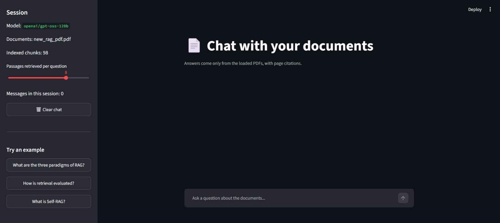
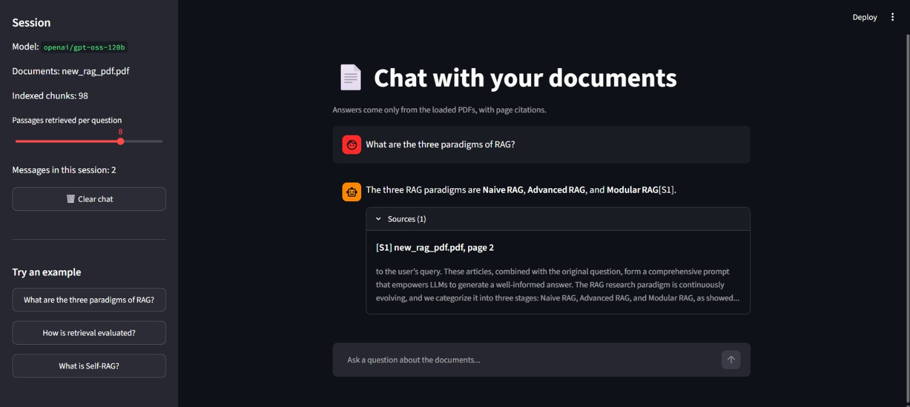
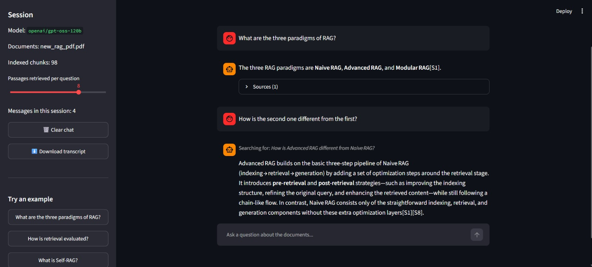
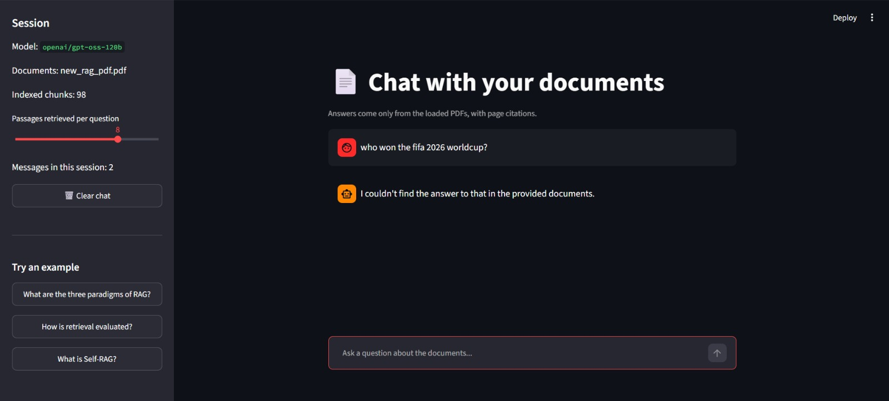

# Interactive AI Chatbot with Streamlit

A browser-based chat app that lets you talk to your documents. It wraps the RAG pipeline from Task 2 in a Streamlit UI with **streaming token output**, **conversation memory**, **page citations**, and explicit **session state management**. Everything runs locally; only the answer generation calls the Groq API.

## Screenshots

| Home | Answer with sources |
|---|---|
|  |  |

| Follow-up question (memory) | Question outside the document |
|---|---|
|  |  |

## Features

- **Streaming answers**: tokens appear live as the model produces them (`st.write_stream`).
- **Conversation memory**: follow-up questions such as "how is the second one different?" work. Before searching, the latest message is rewritten into a standalone question using the recent chat history, and the history is also passed to the answering call. The rewritten query is shown above the answer.
- **Page citations**: answers cite passages as `[S1]`, `[S2]`, and a **Sources** panel under each answer lists the real file name and page number, with a snippet of the cited text.
- **Grounded answers only**: if the documents don't contain the answer, the app says so instead of guessing.
- **Session state**: the conversation lives in `st.session_state`, with a **Clear chat** button and a live message counter.
- **Sidebar controls**: model name, loaded documents, indexed chunk count, a slider for the number of retrieved passages, clickable example questions, and a **Download transcript** button (Markdown, including sources).
- **Friendly errors**: rate limits and invalid keys show a readable message instead of a stack trace.

## How it works

```
user message
    |
    v
rewrite as standalone question (uses recent chat history)
    |
    v
retrieve top-K chunks from ChromaDB (local embeddings)
    |
    v
Groq LLM streams the answer from the passages  ->  st.write_stream
    |
    v
[S#] tags mapped to real file + page numbers  ->  Sources panel
```

## Session state and caching

Streamlit re-runs the whole script on every interaction, so state must be stored deliberately:

- `st.session_state.messages` holds the conversation (role, text, sources, rewritten query). The script re-draws it from this list on every run.
- `@st.cache_resource` loads the vector store, the embedding model and the LLM client **once per server process**, so the first load is slow but every later message is fast.

## Setup

**Requirements:** Python 3.10+ and a free Groq API key (console.groq.com).

```bash
cd task4-streamlit-chatbot
python -m venv venv
venv\Scripts\activate          # macOS/Linux: source venv/bin/activate
pip install -r requirements.txt
copy .env.example .env         # macOS/Linux: cp .env.example .env
```

Fill in `.env`:

```
GROQ_API_KEY=your_key_here
GROQ_MODEL=openai/gpt-oss-120b
```

A test PDF is included in `docs/`: *"Retrieval-Augmented Generation for Large Language Models: A Survey"* (Gao et al., 2024, available on arXiv). All rights belong to the authors. You can also add your own `.pdf` / `.txt` files to `docs/`, then delete the `chroma_db/` folder so the index is rebuilt.

## Run

```bash
python -m streamlit run app.py
```

The app opens at `http://localhost:8501`. The first start takes a minute or two while the embedding model loads and (on the very first run) the documents are indexed.

## Project structure

```
app.py             # Streamlit UI: chat, streaming, sidebar, session state
rag_chat.py        # question rewriting, retrieval, streaming answer, citations
ingest.py          # document loading + recursive chunking
vectorstore.py     # local embeddings + ChromaDB build/load
check_install.py   # verifies the packages are installed
requirements.txt
.env.example
docs/              # input documents
screenshots/       # images used in this README
chroma_db/         # generated vector store (not committed)
```

## Design decisions

- **Self-contained folder.** The indexing code from Task 2 is copied here, so this task runs without the other folders.
- **Memory through question rewriting.** A follow-up like "which page is that from?" would retrieve nothing useful as-is. A short LLM call turns it into a standalone query first, and the app displays that query so the behaviour is visible.
- **Citation tags are stripped from the history.** The `[S#]` numbers refer to the passages of that specific turn, so replaying them in later turns would confuse the model.
- **Page numbers come from metadata.** The model only writes passage tags. The file and page shown to the user are looked up from the stored chunk metadata, so they cannot be invented.
- **Refusals work while streaming.** The first few characters of the stream are held back to detect a `NOT_FOUND` reply, so a refusal is shown as a clean message instead of a flash of raw text.
- **Failed turns are excluded from memory.** An error message is shown to the user but never fed back to the model as conversation history.
- **Bracket normalisation.** The model sometimes writes citation tags with fullwidth brackets (`【S1】`). They are normalised to `[S1]` while streaming.

## Known limitations

- **Session state is per browser session.** Refreshing the page starts a new, empty conversation. Persistent chat history would need a database or file storage.
- The first load is slow because the embedding model has to be loaded into memory.
- Documents are fixed at startup (add files to `docs/` and rebuild); there is no upload widget.
- Memory covers only the last few messages, so very long conversations lose their early context.
- Free-tier API limits can interrupt long sessions (a friendly rate-limit message is shown).
- Runs locally only; it has not been deployed.
- The text-only retrieval can miss rare terms, as noted in Task 2.